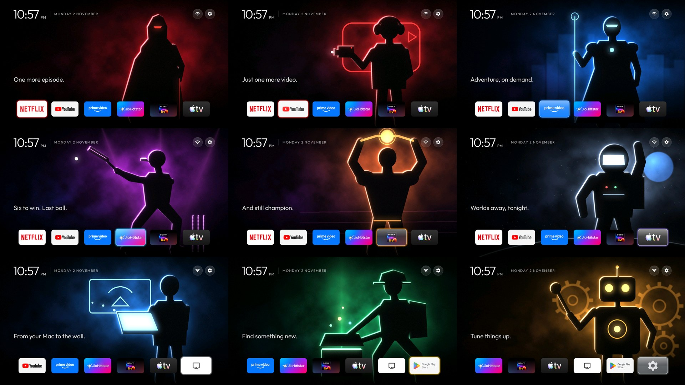

# TV Character Home

Clean up an Android TV or Google TV device, give every app its own full-screen character, and mirror a Mac to it.



Built on [cleanyourtv](https://github.com/Gathin23/cleanyourtv), and not affiliated with it, or with any app or
device maker named here.

## Status: read this first

This has been used on **one device**: a Skyworth "FHD Streaming Stick" running Google TV 14, with a 32-bit chip
and under 1 GB of RAM. On that device, the steps were run by hand, checked after a reboot, and measured for
smoothness.

`setup.sh` packages those steps. It has been tested against a simulated device, **but not yet on a real one**, and
every device is different. Run `--dry-run` first, and please report what happens on yours.

## What it does

| Step | Change | Undo |
|---|---|---|
| Backup | Saves the package list and settings to `backup/` | Not needed |
| Clean-up | Disables ads, telemetry and unused background packages. You choose each optional app | `restore.sh` |
| Home screen | Installs a launcher showing a picture and tagline for the focused app | `restore.sh` |
| AirPlay | Installs an open-source AirPlay receiver, verified by checksum | `restore.sh` |

Nothing that came with the device is uninstalled, and nothing needs root. It never disables the setup wizard, the
stock launcher, Google Cast, Play Store or Play Services. On Google TV the wizard can own your saved Wi-Fi and
holds the Cast credentials, so disabling it can take the device off Wi-Fi and break casting.

It won't work on Samsung Tizen, LG webOS, Roku or Fire TV home screens.

## What you need

- A computer on the same network as the device, with Git and Python 3
- [Android platform tools](https://developer.android.com/tools/releases/platform-tools) (`adb`)
- JDK 17 and Android SDK platform 34 with build-tools 34.0.0, to build the launcher

On macOS:

```bash
brew install --cask android-platform-tools
```

```bash
brew install openjdk@17 android-commandlinetools
```

```bash
sdkmanager "platforms;android-34" "build-tools;34.0.0"
```

## Run it

**1. Turn on debugging.** On the device, open **Settings → About** and press OK on **Build** 7 times. Then open
**Developer options → Wireless debugging** and turn it on.

**2. Pair once.** Choose **Pair device with pairing code**, and use the address and port shown there:

```bash
adb pair DEVICE_IP:PAIRING_PORT
```

**3. Get the repo and preview.** Use the port on the main Wireless debugging screen, which is different from the
pairing port. A dry run changes nothing:

```bash
git clone REPO_URL tv-character-home
```

```bash
cd tv-character-home
```

```bash
./setup.sh DEVICE_IP:PORT --dry-run
```

**4. Run it.** It asks before each step:

```bash
./setup.sh DEVICE_IP:PORT
```

If your model is in [cleanyourtv's tested lists](https://github.com/Gathin23/cleanyourtv/tree/main/examples), use
that list instead, with `--list path/to/debloat.txt`. Other options are `--yes`, `--no-debloat`, `--no-launcher`
and `--no-airplay`.

**5. Finish on the device.** The script ends with a summary and what only you can do: turn on the Home button helper
under **Settings → Accessibility**, test your remote, and close debugging. **Please don't skip closing debugging**,
because it leaves the device open to connection attempts from your network.

On macOS, if `adb` says "No route to host", allow your terminal under **System Settings → Privacy & Security →
Local Network**, then restart it. If it still fails, quit any VPN and restart your Mac.

## Use your own characters

Each app starts with an original neon figure. To use your own pictures, see [pictures/README.md](pictures/README.md).
They stay on your computer, because Git ignores that folder. Film and TV stills usually belong to someone else, so
don't commit or publish them.

## Mirror a Mac

Open **Control Center → Screen Mirroring** and choose the name ending in **Screen**. Protected video, such as the
Apple TV app, won't play over this receiver. On weak devices mirrored video may lag.

## Known limits

Seen on the one tested device, and may differ on yours:

- **Held volume:** the Home button helper made held volume move one step per press. Turning the helper off brings
  repeat back, but Google TV's home returns.
- **Sleep:** if you disable the screensaver, the device goes straight to sleep when idle.
- **Speed:** clean-up helps, but it can't add memory. Don't expect a low-end device to become fast.
- **Firmware updates** can turn disabled apps back on.
- **Debugging:** Wireless debugging switches itself off at every reboot on that device.

Reported on similar devices, and not tested here:

- **Remote shortcut buttons** such as YouTube may stop working.
- **After a reboot**, the stock home may show until you press Home once.

## Smoothness on the tested device

20 D-pad presses, 0.75s apart, using the launcher's own frame statistics:

| | Plain launcher | With character pictures |
|---|---|---|
| Janky frames | 0 of 186 | 2 of 578 |
| 99% of frames within | 10 ms | 15 ms |
| Launcher memory | 45 MB | 55 MB |

Pictures are decoded only when focus settles on a tile, and at most two are held in memory, during the fade.

## Undo

Re-enable everything and remove the launcher and AirPlay:

```bash
./restore.sh DEVICE_IP:PORT
```

Or re-enable everything and keep both:

```bash
./restore.sh DEVICE_IP:PORT --keep
```

This needs Wireless debugging on, and the same copy of this repo, because the record of what changed is in
`state/`. Keep `state/` and `backup/` private: they describe your device.

## How it works

`setup.sh` fetches cleanyourtv at a fixed version, applies `launcher/app-art.patch`, and uses that project's
scripts and their safety checks. The patch adds one behaviour: a picture named `art_<package>.jpg` is shown while
that app's tile has focus.

## Credits and licences

- This repo: [MIT](LICENSE)
- [cleanyourtv](https://github.com/Gathin23/cleanyourtv) by Gathin, MIT, fetched at setup
- [AirPlay Receiver for Android](https://github.com/jqssun/android-airplay-server) by jqssun, GPL-3.0, downloaded at
  setup and not included here
- The neon figures are original, drawn by `art/make_avatars.py`, and covered by this repo's licence

Use this at your own risk. It changes how your device behaves, and it comes with no warranty.
